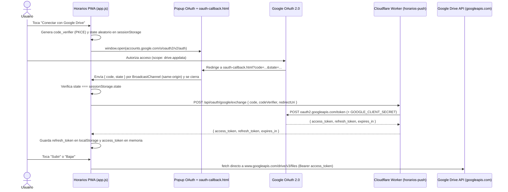

# Propuesta técnica y análisis de seguridad — Respaldo en Google Drive

**Fecha:** 2026-10-17  
**Alcance:** `app.js`, `index.html`, `styles.css`, `sw.js` y `horarios-push/src/index.js`  
**Objetivo:** Incorporar Google Drive como opción de respaldo y sincronización en la nube (manual y automática), con botón propio en **Ajustes → Datos**, manteniendo los estándares de seguridad de `ROADMAP-SEGURIDAD-HORARIOS.md`.

---

## 1. Contexto y condicionantes de la aplicación

1. **PWA estática en GitHub Pages** (`l-lus.github.io`, `lushibosca.github.io`): no hay backend de base de datos propio; toda la persistencia primaria vive en `localStorage`.
2. **CSP estricta en `<meta>`** (`index.html:8-20`):
   - `script-src 'self'` (sin scripts inline ni librerías de terceros).
   - `connect-src 'self' https://api.github.com https://horarios-push.lushibosca.workers.dev`.
3. **Origen compartido**: varias aplicaciones conviven bajo el mismo dominio `*.github.io` y comparten `localStorage`.
4. **Infraestructura existente**: ya existe el Worker de Cloudflare `horarios-push` (`horarios-push/src/index.js`) con rate limiting nativo por IP/subred, validación de `Origin` y lectura acotada de body.
5. **Modelo de sincronización probado**: `GistSync` (`app.js:4840-5011`) y `UIGistYRespaldo` (`app.js:5016-5903`) ya implementan hash de integridad SHA-256, cálculo de diferencias, modal interactivo de **Combinar / Reemplazar** y sincronización automática por perfil con ventana horaria y límite por hora.

---

## 2. Evaluación de alternativas técnicas

A diferencia de GitHub Gist, **Google Drive no ofrece Personal Access Tokens estáticos**. Toda integración con la API de Google Drive requiere **OAuth 2.0**, donde los `access_token` tienen una vida fija de **1 hora (3600 segundos)**.

Para lograr que el respaldo manual y la **sincronización automática al abrir la app** funcionen sin pedirle al usuario que inicie sesión cada hora, se evaluaron tres arquitecturas:

| Criterio | Opción A (Recomendada)<br>OAuth 2.0 + PKCE vía Worker `horarios-push` | Opción B<br>OAuth 2.0 Implicit Flow (100% Frontend) | Opción C<br>Google Apps Script por usuario |
| :--- | :--- | :--- | :--- |
| **Experiencia de usuario (UX)** | **Excelente:** 1 clic en *"Conectar con Google Drive"*, sin copiar tokens ni IDs. | **Regular:** el login vence a la hora; obliga a re-autorizar en un popup frecuente. | **Mala:** cada usuario debe crear y desplegar un script en su cuenta y pegar la URL. |
| **Sincronización automática al abrir** | **Completa:** el `refresh_token` renueva el acceso en segundo plano sin intervención. | **Inviable en la práctica:** al día siguiente el token ya expiró. | **Completa:** la URL del script no vence. |
| **Impacto en `script-src 'self'`** | **Ninguno:** no se carga el SDK de Google (`gsi/client`). Todo es `fetch` nativo. | **Ninguno** si se hace con popup manual; requiere SDK externo si se usa silencioso. | **Ninguno.** |
| **Consumo de KV en Cloudflare** | **0 lecturas / 0 escrituras:** el Worker solo actúa como proxy stateless de OAuth. | **0** (no usa el Worker). | **0** (no usa el Worker). |
| **Seguridad del secreto OAuth** | `GOOGLE_CLIENT_SECRET` aislado en secretos de Cloudflare (`wrangler secret`). | No usa `client_secret` (por eso Google no entrega `refresh_token`). | Cada usuario administra su propio script. |

### Conclusión arquitectónica
La **Opción A** es la más sólida: aprovecha el Worker `horarios-push` que ya está en producción para guardar el `GOOGLE_CLIENT_SECRET` y emitir/renovar tokens, sin gastar cuota de KV ni cargar scripts de Google en el navegador.

---

## 3. Elección del permiso (Scope) en Google Drive

Google ofrece dos scopes clasificados como **no sensibles** (*non-sensitive*), lo que significa que la aplicación en Google Cloud Console **no requiere verificación ni auditoría de seguridad paga** para ser usada por los ~50 usuarios:

### Alternativa 3.1: `https://www.googleapis.com/auth/drive.appdata` *(Recomendada)*
Guarda los respaldos en el espacio oculto de datos de aplicación (`appDataFolder`) dentro del Google Drive del usuario.
* **Ventajas de UX:** el usuario no tiene que tocar ni configurar ningún ID de archivo; la app busca automáticamente `horarios_backup_<perfilId>.json` (o guarda el `driveFileId` en el perfil) y el usuario no puede borrarlo ni corromperlo por accidente desde la interfaz de Google Drive.
* **Ventajas de seguridad:** incluso ante un robo de token, este permiso **solo permite leer y escribir dentro de la carpeta oculta de Horarios**. No permite ver nombres, carpetas ni ningún otro archivo del Google Drive del usuario.

### Alternativa 3.2: `https://www.googleapis.com/auth/drive.file`
Crea un archivo visible `horarios_backup.json` en la raíz (o carpeta elegida) del Google Drive del usuario, dando acceso únicamente a los archivos creados por la propia app.
* **Ventaja:** el usuario puede ver el archivo en su unidad de Drive (similar al botón *"Abrir en GitHub"* de Gist) o compartir el ID entre perfiles.
* **Desventaja:** si el usuario lo mueve a la papelera o lo edita manualmente en Drive, la sincronización falla o salta la alerta de hash inválido.

> **Recomendación:** Usar **`drive.appdata`** por defecto por su simplicidad (cero configuración tras iniciar sesión) y mínimo privilegio, o bien **`drive.file`** si se desea mantener un campo opcional de `File ID` + botón *"Abrir en Drive"* idéntico a la experiencia actual de Gist.

---

## 4. Diseño de Interfaz (UI) e Integración en el Código

### 4.1. Botón propio en `Ajustes → Datos` (`index.html:880-920`)
En la lista `.settings-list` de la sección **Datos**, se agrega el botón dedicado **Google Drive** justo debajo de **GitHub Gist**:

```html
<button class="btn-gist">
    <svg class="icon"><use href="#icon-gist" /></svg>
    <span>GitHub Gist</span>
    <svg class="icon icon-indicator"><use href="#icon-chevron-right" /></svg>
</button>
<button class="btn-drive">
    <svg class="icon"><use href="#icon-drive" /></svg>
    <span>Google Drive</span>
    <svg class="icon icon-indicator"><use href="#icon-chevron-right" /></svg>
</button>
```
*(Se añade el `<symbol id="icon-drive">` monocromático `currentColor` al sprite SVG de `index.html` para que respete los 9 temas de la app).*

### 4.2. Modal de configuración de Google Drive (`#modal-drive`)
Sigue exactamente la estructura visual y ergonómica de `#modal-gist` (`index.html:1244-1421`), manteniendo coherencia total en la app:

1. **Cabecera de estado (`#drive-estado`):**
   - Muestra `Sin conectar` o `Conectado` (junto con el email o indicador de cuenta vinculada) y `Última sync: dd/mm/aaaa hh:mm`.
2. **Sección Conexión:**
   - Si no está conectado: botón **Conectar con Google Drive** (abre el flujo OAuth).
   - Si está conectado: estado de la sesión, ID del archivo asociado al perfil activo y botón **Desconectar cuenta** (que revoca el token y limpia las credenciales).
3. **Sección Automatización (por perfil):**
   - **Sincronización automática:** alterna entre `Sin automatizar` (0), `Restaurar al abrir` (1) y `Respaldar al abrir` (2).
   - **Al bajar datos:** alterna entre `Reemplazar` y `Combinar` (activo cuando el modo automático es `Restaurar`).
   - **Límites y horario (colapsable):** límite de ejecuciones por hora (`0 = sin límite`, por defecto 2 bajadas / 1 subida) y franja horaria `Desde` / `Hasta` (por defecto `21:00` a `00:00`).
4. **Acciones manuales (`Subir` / `Bajar`) y pie del modal (`Guardar` / `Volver`).**

### 4.3. Accesos rápidos en la tarjeta de Registros (`actualizarBotonesHistorico`, `app.js:5312-5345`)
Los botones rápidos de la barra del histórico (`#btn-hist-respaldar` y `#btn-hist-restaurar`) hoy cambian entre archivo local y Gist según si hay Gist configurado. Con Google Drive:
- Si el perfil activo tiene **solo Gist** conectado → sube/baja de Gist.
- Si el perfil activo tiene **solo Google Drive** conectado → sube/baja de Google Drive.
- Si el perfil tiene **ambos** conectados → prioriza el que tenga **Sincronización automática activa** en ese perfil (o el último sincronizado `lastSync`), evitando agregar botones extra en la barra compacta.
- Si no tiene ninguno → abre los modales de Respaldar / Restaurar archivo local.

### 4.4. Factorización en `app.js` para evitar duplicación
En lugar de duplicar las ~400 líneas de `UIGistYRespaldo`, se reutilizan los componentes comunes:
- **Módulo `DriveSync`**: implementa la misma interfaz pública que `GistSync` (`subir()`, `bajar()`, `getLastSync()`, `getAutoSync()`, ` getMergeBehavior()`, `dentroDelRangoHorario()`, `superaLimite()`, `marcarSync()`).
- **Validación y Merge compartidos**: `_validarDatosGist` (`app.js:5627`), `_calcularDiffGist` (`app.js:5647`), `_calcularRegistrosMerge` (`app.js:5387`) y el modal `#modal-gist-merge` reciben un parámetro `origen` (`'Gist'` | `'Google Drive'`) para adaptar únicamente los textos del título, alertas y mensajes de `HistoryManager` (`"reemplazar con Google Drive"` / `"combinar con Google Drive"`).
- **Guardado por perfil (`PerfilManager`)**: cada perfil almacena sus propias propiedades `driveFileId`, `driveLastSync`, `driveAutoSync`, `driveMergeBehavior`, `driveRangoDesde`, `driveRangoHasta`, mientras que el `driveRefreshToken` es global a todos los perfiles (igual que `gistToken`).

---

## 5. Flujo técnico paso a paso (OAuth 2.0 + PKCE + Drive REST API)



### Operaciones contra la API de Google Drive (directas desde el navegador)
1. **Buscar o crear archivo al subir (`DriveSync.subir`)**:
   - Si el perfil ya tiene `driveFileId` válido: hace `PATCH https://www.googleapis.com/upload/drive/v3/files/{fileId}?uploadType=media` con el JSON.
   - Si no tiene `driveFileId` (o devuelve `404`): crea el archivo con `POST https://www.googleapis.com/upload/drive/v3/files?uploadType=multipart` enviando los metadatos (`{ name: 'horarios_backup.json', parents: ['appDataFolder'] }`) y el cuerpo JSON, y guarda el `id` resultante en `perfil.driveFileId`.
2. **Descargar archivo (`DriveSync.bajar`)**:
   - `GET https://www.googleapis.com/drive/v3/files/{fileId}?alt=media` con header `Authorization: Bearer <access_token>`.
3. **Renovación transparente de token**:
   - El `access_token` y su timestamp de expiración (`expiresAt`) se mantienen en memoria. Si faltan menos de 60 segundos para vencer (o no existe en memoria tras recargar la página), `DriveSync` llama primero a `POST /api/oauth/google/refresh` en el Worker enviando el `refresh_token` y obtiene un `access_token` fresco.

---

## 6. Análisis de Seguridad

Siguiendo la metodología de `ROADMAP-SEGURIDAD-HORARIOS.md`, se analizan todos los vectores de ataque que introduce esta funcionalidad y los controles que deben implementarse desde el diseño.

### 6.1. Criptografía y flujo OAuth 2.0 (Prevención de CSRF, robo de código y Open Redirect)

| ID | Vector / Riesgo | Control de seguridad a implementar |
| :--- | :--- | :--- |
| **DRV-SEC-1** | **CSRF en el callback OAuth** (un atacante intenta vincular su propia cuenta de Google Drive a la app de la víctima para inyectarle registros falsos o leer lo que la víctima suba). | Generar un parámetro `state` de 32 bytes aleatorios con `crypto.getRandomValues` antes de abrir el popup, guardarlo en `sessionStorage` (que no se comparte entre pestañas ajenas y muere al cerrar) y exigir coincidencia exacta (`stateRecibido === stateGuardado`) antes de canjear el código. Consumir y borrar el `state` inmediatamente. |
| **DRV-SEC-2** | **Intercepción del `authorization_code`** en tránsito o en historial. | Uso obligatorio de **PKCE (`S256`)**: el navegador genera un `code_verifier` criptográfico aleatorio de 43-128 caracteres base64url, envía `code_challenge = BASE64URL(SHA256(code_verifier))` a Google y luego envía el `code_verifier` al Worker para el canje. Sin el `code_verifier`, el `code` interceptado es inútil. |
| **DRV-SEC-3** | **Fuga del código en la página de retorno (`oauth-callback.html`)**. | `oauth-callback.html` debe tener su propia CSP estricta (`default-src 'none'; script-src 'self'`), `<meta name="referrer" content="no-referrer">`, limpiar inmediatamente la URL con `history.replaceState(null, '', location.pathname)` antes de hacer nada, transmitir `{ code, state }` únicamente mediante `BroadcastChannel('horarios_oauth_drive')` (que el navegador restringe por especificación al mismo origen exacto) y ejecutar `window.close()`. |
| **DRV-SEC-4** | **Abuso del Worker como proxy OAuth por orígenes no autorizados (`redirect_uri` spoofing)**. | El Worker **no debe aceptar cualquier `redirectUri` enviada por el cliente**. Debe validar que `redirectUri` pertenezca a una lista blanca estricta derivada de `ALLOWED_ORIGINS` (ej. `https://l-lus.github.io/Horarios/oauth-callback.html`, `https://lushibosca.github.io/Horarios/oauth-callback.html` y `localhost` en desarrollo). |

### 6.2. Seguridad en el Worker de Cloudflare (`horarios-push`)

1. **Protección del `GOOGLE_CLIENT_SECRET`**:
   - Se almacena exclusivamente como secreto cifrado de Cloudflare (`npx wrangler secret put GOOGLE_CLIENT_SECRET`). Nunca aparece en el código fuente ni en `wrangler.toml`.
2. **Reutilización de `verificarAcceso(request, env)` (`horarios-push/src/index.js:228`)**:
   - Los dos nuevos endpoints (`/api/oauth/google/exchange` y `/api/oauth/google/refresh`) pasan por el mismo filtro inicial que `/api/schedule` y `/api/cancel`:
     - Rate limit nativo (`env.RATE_LIMITER.limit`) por IPv4 o subred `/64` IPv6 (`claveIP`).
     - Verificación estricta del header `Origin` contra `esOrigenPermitido(origin)`.
     - Verificación de `X-App-Secret` (`tieneSecretoValido`).
3. **Aislamiento de la cuota de KV**:
   - Ninguno de los endpoints de OAuth toca `env.HORARIOS_KV`. Si un atacante enviara ráfagas de tokens inválidos, lo frena `RATE_LIMITER` sin gastar ni una sola lectura/escritura del KV que usan las notificaciones push.
4. **Validación estricta del body (`leerBodyJSON`)**:
   - Se limita el tamaño máximo del body a `2048` bytes.
   - Se valida con expresiones regulares el formato de `code` (`/^[A-Za-z0-9/_-]+$/`, máx. 512 chars), `codeVerifier` (`/^[A-Za-z0-9_-]{43,128}$/`) y `refreshToken` (`/^[A-Za-z0-9._/-]{20,512}$/`) antes de hacer el subrequest a `https://oauth2.googleapis.com/token`.
5. **No exposición de errores internos de Google**:
   - El Worker devuelve únicamente `{ accessToken, refreshToken, expiresIn }` (con `Cache-Control: no-store`) o un código de error genérico (`400` / `401`), sin reenviar cabeceras ni trazas crudas.

### 6.3. Seguridad en el Frontend (`app.js`, `index.html`)

1. **Conservación de `script-src 'self'` en la CSP**:
   - No se incluye `<script src="https://accounts.google.com/gsi/client">`. Esto evita que código externo de terceros se ejecute con acceso al DOM y al `localStorage` de todas las apps del dominio.
   - En `index.html:13`, `connect-src` solo suma los endpoints REST de Google:
     ```http
     connect-src 'self' https://api.github.com https://horarios-push.lushibosca.workers.dev https://www.googleapis.com https://oauth2.googleapis.com;
     ```
2. **Validación de `driveFileId` antes de construir URLs (SSRF / Path Traversal en cliente)**:
   - Igual que `GistSync.esGistIdValido` (`app.js:4845`), se define `DriveSync.esFileIdValido(id)` con regex estricta `/^[a-zA-Z0-9_-]{10,80}$/`. Nunca se interpola un `driveFileId` en una URL de `fetch` ni en `window.open` sin pasar antes por este validador.
3. **Defensa contra respuestas gigantes o corruptas desde Google Drive**:
   - Al descargar el archivo desde Drive (`GET .../files/{id}?alt=media`), se lee el texto verificando que no supere `S.SECURITY_LIMITS.MAX_JSON_SIZE` (4 MB) **antes** de llamar a `JSON.parse(texto, S.reviverJSONSeguro)`.
   - Se verifica `data.registros.length <= S.SECURITY_LIMITS.MAX_REGISTROS` **antes** de `normalizarRegistrosImportados` (aplicando de paso la mejora `GIST-1` y `GIST-2` del roadmap de seguridad tanto a Drive como a Gist).
   - Se exige la misma allowlist de claves raíz (`registros`, `diasHabiles`, `horasDiarias`, `historialDiasHabiles`, `fecha`, `version`, `hash`, `timestamp`) y la confirmación interactiva si el hash SHA-256 falta o no coincide.
4. **Almacenamiento del token y riesgo del origen compartido**:
   - El `driveRefreshToken` se guarda en `localStorage` (el `access_token` de corta duración se mantiene solo en una variable privada en memoria dentro de la clausura de `DriveSync`).
   - **Impacto ante un eventual XSS en otra app del mismo dominio (`lushibosca.github.io`)**: gracias al uso del scope restringido `drive.appdata` (o `drive.file`), el token almacenado en `localStorage` **no da acceso a la cuenta de Google ni a los documentos del usuario**, sino exclusivamente al archivo JSON de respaldos de Horarios. Esto cumple estrictamente con el principio de mínimo privilegio.
5. **Revocación real al desconectar**:
   - Cuando el usuario toca *"Desconectar"*, además de borrar `driveRefreshToken` de `localStorage` y limpiar el token en memoria, se envía un `POST https://oauth2.googleapis.com/revoke?token=<token>` para invalidar la credencial en los servidores de Google.

---

## 7. Plan de implementación paso a paso

1. **Fase 1 — Configuración en Google Cloud Console (5 min):**
   - Crear proyecto en Google Cloud Console → habilitar **Google Drive API**.
   - Configurar pantalla de consentimiento OAuth con el scope `.../auth/drive.appdata` (o `drive.file`).
   - Crear credencial **ID de cliente de aplicación web**, autorizando los orígenes de GitHub Pages y la URI de redirección `.../oauth-callback.html`.
   - Cargar `GOOGLE_CLIENT_ID` y `GOOGLE_CLIENT_SECRET` en el Worker (`wrangler secret put`).

2. **Fase 2 — Endpoints OAuth en `horarios-push/src/index.js`:**
   - Agregar rutas `POST /api/oauth/google/exchange` y `POST /api/oauth/google/refresh` protegidas por `verificarAcceso`, `leerBodyJSON` y validación de `redirectUri`.

3. **Fase 3 — Página `oauth-callback.html` y actualización de `sw.js` / `index.html`:**
   - Crear `oauth-callback.html` + `oauth-callback.js` (estáticos, con CSP propia, sin inline scripts).
   - Actualizar `connect-src` en `index.html`.
   - Agregar ícono `#icon-drive`, botón **Google Drive** en `Ajustes → Datos` y el modal `#modal-drive`.
   - Añadir la sección explicativa de Google Drive en el modal de **Ayuda** (`#modal-ayuda`).

4. **Fase 4 — Módulo `DriveSync` y factorización en `app.js`:**
   - Implementar `DriveSync` (PKCE, manejo de token en memoria, subida/bajada multipart/media y límites por perfil).
   - Unificar la validación y el modal de merge con `UIGistYRespaldo`.
   - Conectar `_initAutoSync()` y `actualizarBotonesHistorico()` para que soporten ambos proveedores.
